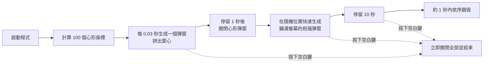

# 愛情進行時 (Love in Progress)


愛情進行時 (Love in Progress) 是一個基於 Python Tkinter 開發的趣味彈窗動畫程式。它會在螢幕上以數學心形曲線軌跡動態繪製多個置頂的溫馨提示視窗，隨後在螢幕隨機位置鋪滿祝福彈窗，並在指定時間後以動畫形式快速依序銷毀所有視窗。這是一個適合用於告白、節日驚喜或個人溫馨提醒的趣味小工具。


<p align="center">
  
</p>

## 目錄

- [執行畫面](#執行畫面)
- [快速開始](#快速開始)
- [功能特點](#功能特點)
- [執行流程](#執行流程)
- [自訂配置](#自訂配置)
- [程式碼架構](#程式碼架構)
- [常見問題](#常見問題)
- [參與貢獻](#參與貢獻)
- [授權條款](#授權條款)

---

## 執行畫面

> 以下截圖是在 1280×800 解析度的 Linux 桌面上拍攝。在 Windows 或 macOS 上，視窗外框與字型會依系統而有所不同。

| ① 心形軌跡繪製 | ② 隨機祝福彈窗生成中 |
| :---: | :---: |
|  |  |
| 100 個彈窗依序沿心形曲線出現，最後一個顯示「充實自己」 | 心形消失後，祝福彈窗開始在螢幕隨機位置出現 |
| **③ 鋪滿整個螢幕** | **④ 依序快速銷毀** |
|  |  |
| 彈窗鋪滿螢幕並停留約 10 秒 | 約 1 秒內依序關閉所有彈窗 |

### 示範影片

完整執行過程（約 22 秒，1280×800，MP4）：[▶️ 觀看示範影片 demo.mp4](docs/screenshots/demo.mp4)

[](docs/screenshots/demo.mp4)

---

## 快速開始

### 系統要求

- 已安裝 Python 3.x 環境。
- 已安裝 Tkinter 元件。
  - **Windows**：多數 Python 安裝程式已預設內建。
  - **macOS**：若透過 Homebrew 安裝 Python，通常已內建。若未內建，可執行 `brew install python-tk`。
  - **Linux**（例如 Ubuntu/Debian）：若未安裝，請在終端機中執行：
    ```bash
    sudo apt-get install python3-tk
    ```

### 執行步驟

請在終端機中執行以下命令來啟動程式：

```bash
python Love-in-Progress.py
```

### 操作與安全機制

> [!IMPORTANT]
> **安全退出鍵**：在程式執行期間，任何時候按下 **空白鍵 (Space)** 即可立即關閉所有已生成的彈窗並安全結束程式。此機制旨在防止彈窗干擾您的正常電腦操作。

---

## 功能特點

- **心形軌跡繪製**：利用心形數學公式計算出 100 個螢幕座標點，依序動態生成彈窗，在螢幕中央拼出一個愛心形狀。
- **隨機祝福彈窗**：心形彈窗消失後，會在螢幕隨機位置快速生成鋪滿螢幕的隨機祝福語彈窗。
- **自動銷毀動畫**：所有隨機彈窗在顯示 10 秒後，會以極快的速度依序銷毀，呈現收縮消失的視覺效果。
- **隨機祝福語與顏色**：每次生成的彈窗會隨機從預設的溫馨詞庫與粉嫩色系庫中挑選。
- **安全退出機制**：任何時候按下空白鍵即可瞬間關閉所有產生的視窗並結束程式。

---

## 執行流程



| 階段 | 大約時間 |
| :--- | :--- |
| 心形軌跡繪製 | 約 3～4 秒 |
| 心形停留 | 1 秒 |
| 隨機彈窗鋪滿 | 數秒（依螢幕解析度而定） |
| 全螢幕停留 | 10 秒 |
| 依序銷毀 | 約 1 秒 |

---

## 自訂配置

您可以直接編輯 [Love-in-Progress.py](./Love-in-Progress.py) 中的變數來進行個人化配置：

| 變數或函數 | 說明 | 預設值 |
| :--- | :--- | :--- |
| `t` | 彈窗顯示的祝福語列表 | `["愛你老幾", "好好愛自己", "好好吃飯", "保持好心情", "我想你了", "順順利利", "別熬夜", "天涼了多穿衣服"]` |
| `c` | 彈窗背景顏色列表 | `["pink", "lightblue", "lightgreen", "lemonchiffon", "hotpink", "skyblue"]` |
| `n` | 心形軌跡的彈窗數量 | `100` |
| `wx` 函數中的字型 | 彈窗文字的字型與大小 | `("Microsoft YaHei", 14)` |
| `wx` 函數中的尺寸 | 每個彈窗的寬度與高度 | `150x60` |

---

## 程式碼架構

本專案主要由單一檔案 [Love-in-Progress.py](./Love-in-Progress.py) 組成。核心函式如下：

- **`g(n, w, h)`**：心形曲線座標生成函數。使用經典的愛心曲線公式計算出 `n` 個點的座標，並將其映射至螢幕中央區域。
- **`wx(x, y, tip=None, is_h=True)`**：建立置頂的 `tk.Toplevel` 提示視窗，並為其綁定空白鍵退出事件。
- **`w()`**：主控制流程。負責初始化視窗環境、動態生成心形軌跡彈窗、延時銷毀、生成鋪滿螢幕的隨機彈窗，以及最後的依序淡出銷毀動畫。

---

## 常見問題

**Q：執行時出現 `ModuleNotFoundError: No module named 'tkinter'`？**
A：您的 Python 沒有安裝 Tkinter，請依照上方「系統要求」安裝對應套件。

**Q：彈窗上的中文顯示為方框或字型不同？**
A：程式預設使用「Microsoft YaHei」字型。若系統沒有此字型，Tkinter 會改用其他字型；在 Linux 上可安裝中文字型（例如 `sudo apt-get install fonts-wqy-zenhei`），或將 `wx` 函數中的字型改為系統已有的中文字型。

**Q：按下空白鍵沒有反應？**
A：空白鍵事件綁定在彈窗上，請先用滑鼠點選任一彈窗，讓它取得鍵盤焦點後再按空白鍵。

**Q：彈窗數量太多，電腦變慢？**
A：隨機彈窗數量會依螢幕解析度計算，高解析度螢幕會產生較多視窗。可調整 `w()` 中 `range(sw//150 * sh//40 + 50)` 的計算方式來減少數量。

---

## 參與貢獻

歡迎提交 Issue 或 Pull Request！開始之前請先閱讀：

- [貢獻指南](./CONTRIBUTING.md)：開發環境、Commit 規範與 Pull Request 流程
- [行為準則](./CODE_OF_CONDUCT.md)：參與社群的互動規範
- [安全性政策](./SECURITY.md)：如何私下回報安全性漏洞
- [無障礙聲明](./ACCESSIBILITY.md)：支援環境、已知限制與回報管道

---

## 授權條款

本專案採用 [MIT License](./LICENSE) 授權釋出。
